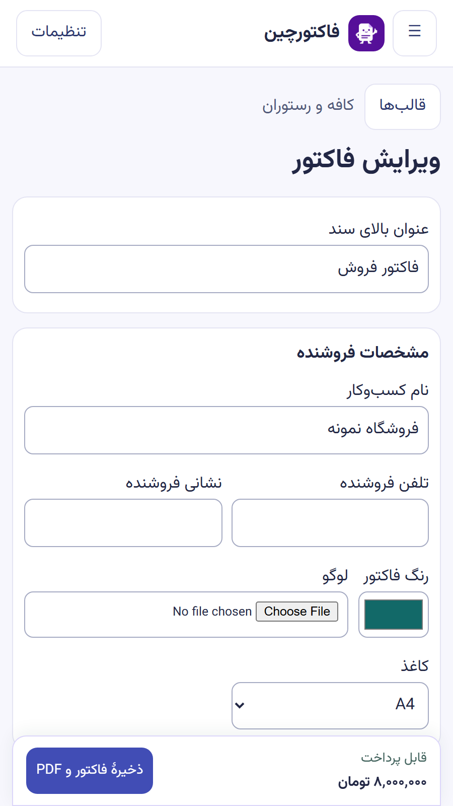
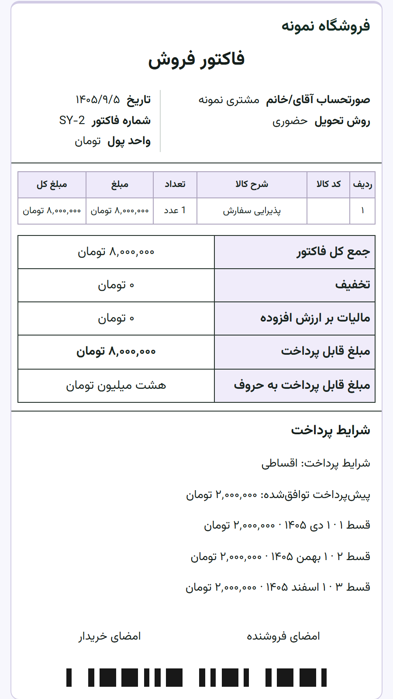
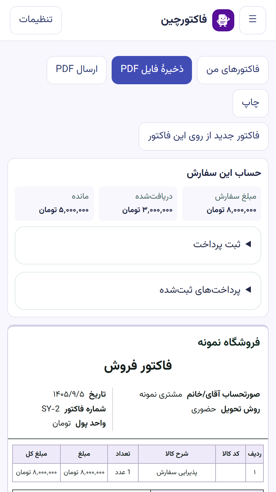

# Factorchin

Factorchin is a Persian-language Android app for creating invoices, tracking payments and installments, and exporting invoices as PDFs.

## Screenshots

The screenshots use sample records from a browser test of the app interface.

| Create an invoice | Preview the invoice | Track payments |
| --- | --- | --- |
|  |  |  |

## Run locally

1. Install Android Studio with JDK 17, Android SDK Platform 35, and Android SDK Build-Tools 35.0.0.
2. Clone the repository and open its root folder in Android Studio.
3. Sync Gradle, then click **Run** and choose an emulator or device running Android 8.0 (API 26) or later.

To build a debug APK from the repository root, run `./gradlew assembleDebug` on macOS or Linux, or `.\gradlew.bat assembleDebug` in Windows PowerShell. Gradle writes the APK to `app/build/outputs/apk/debug/`.

See the [Persian project guide](README.fa.md) for more details.
